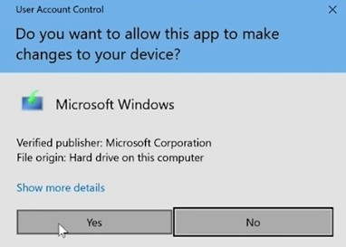
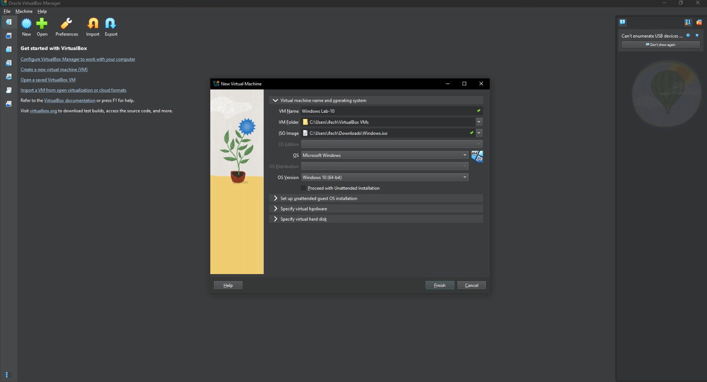
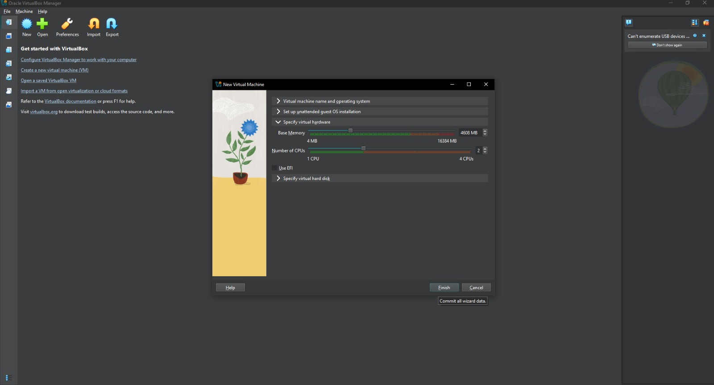
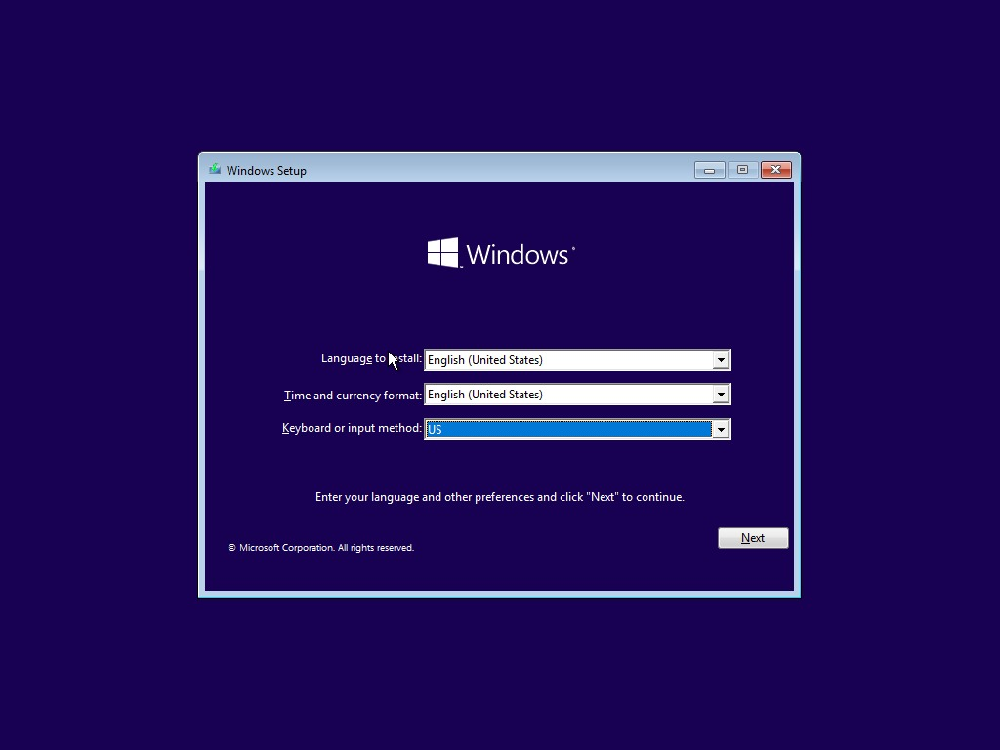
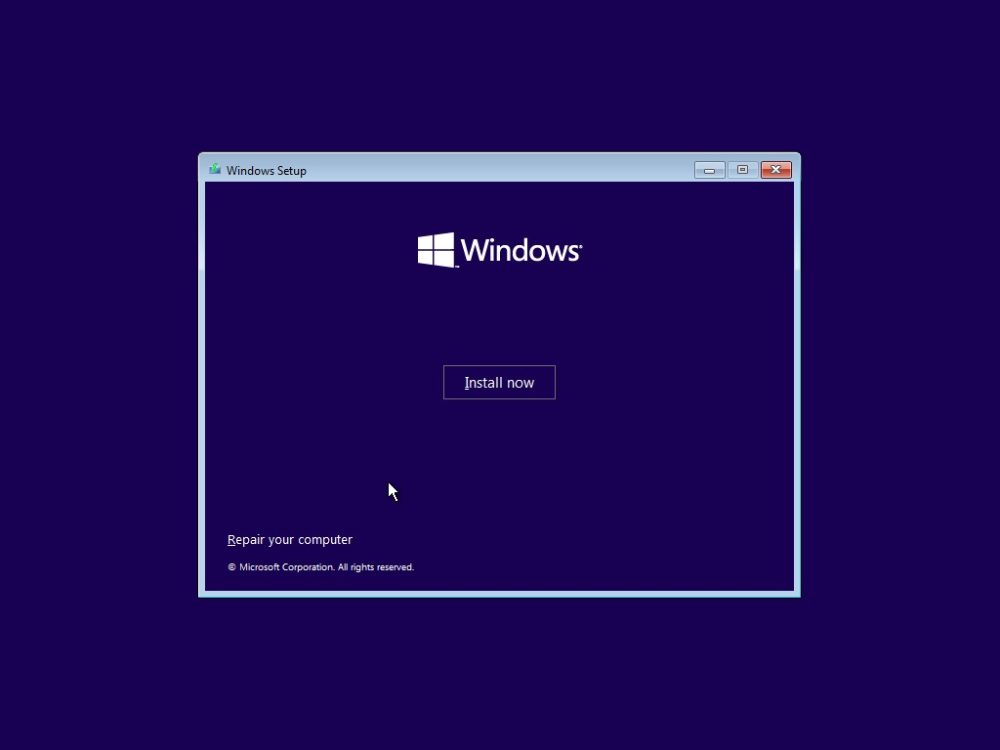
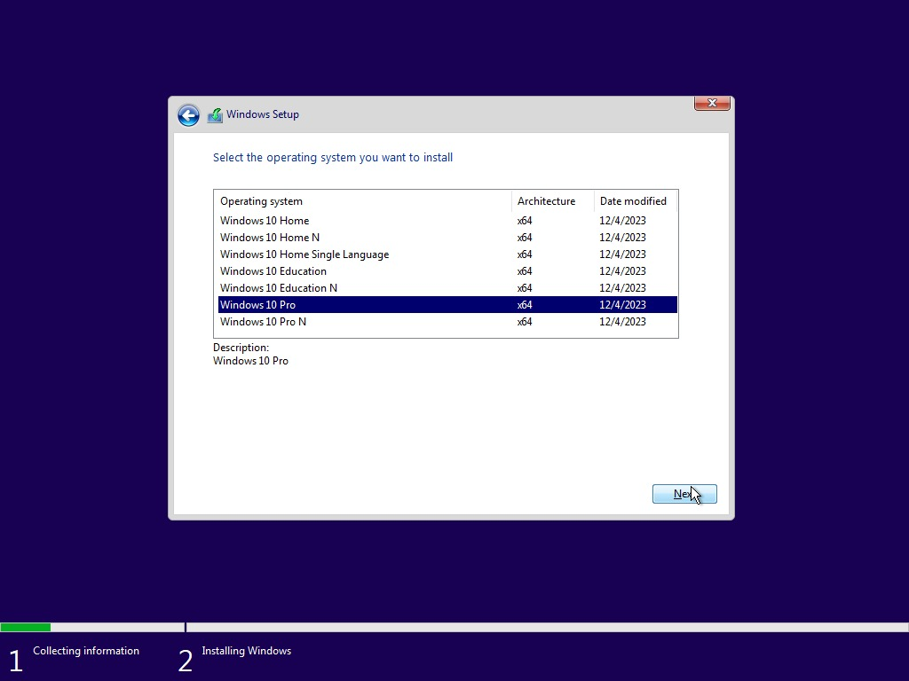
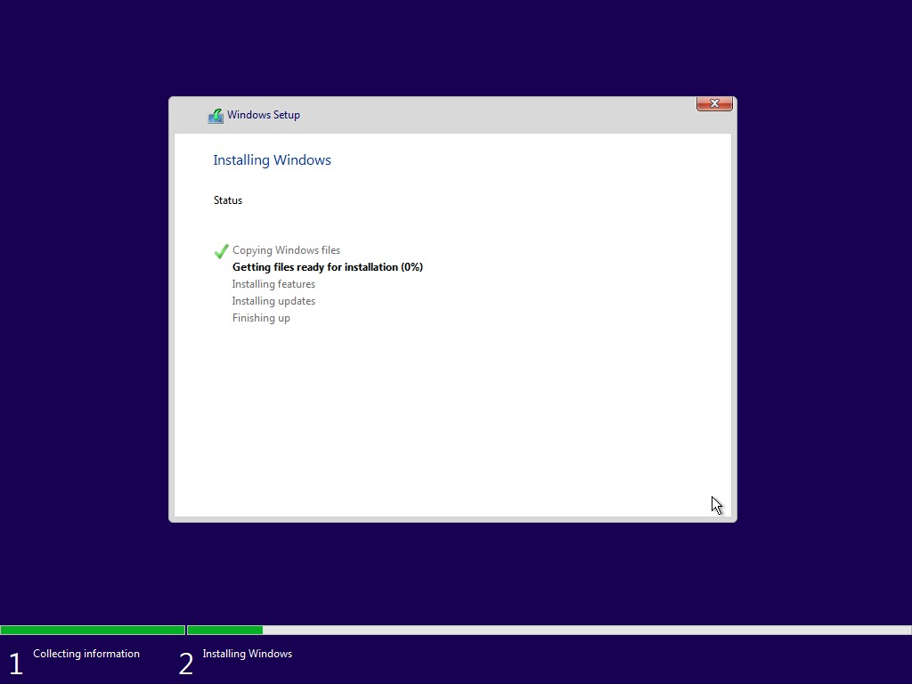
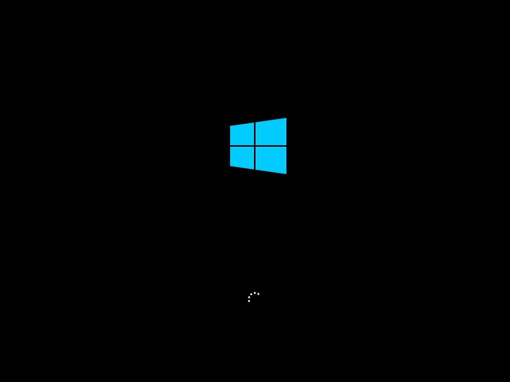
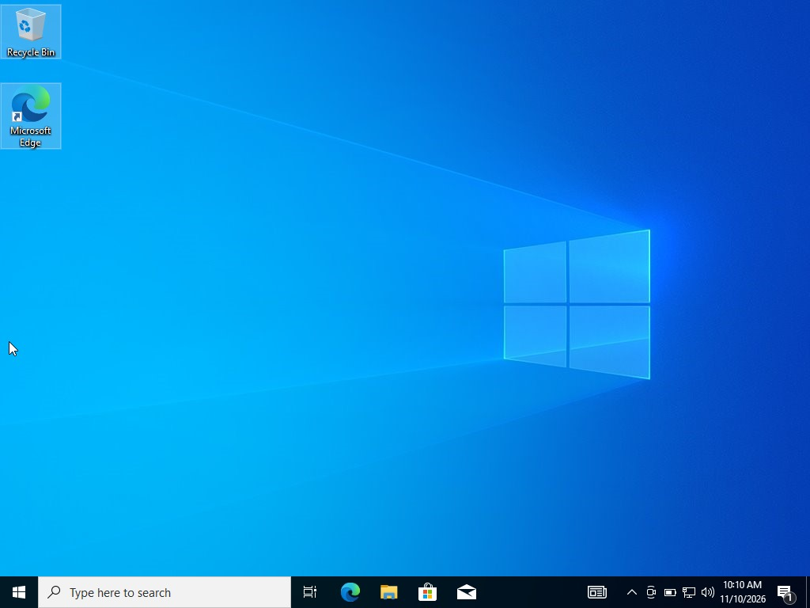

# Windows 10 Lab, Virtual Installation

A Windows 10 Pro virtual machine, built in VirtualBox on my own laptop. I made the Windows ISO myself with Microsoft's Media Creation Tool, created the VM, and ran Windows Setup by hand until I reached the desktop. This report shows the settings I used and the steps in order.

## The Windows 10 pro VM Details 

| Item | Detail |
|---|---|
| Host machine | Windows 10 Pro, 16 GB RAM, Intel Core i7 |
| Virtualization software | Oracle VirtualBox 7.2.22 |
| VM name | Windows Lab-10 |
| Guest OS | Windows 10 Pro (64-bit) |
| Installation source | `Windows.iso`, made with the Windows 10 Media Creation Tool |
| Memory | 4608 MB |
| CPUs | 2 |
| Virtual disk | 50 GB |
| EFI | Off |
| Unattended installation | Off (I ran Windows Setup myself) |

## Steps on how I install it

1. **Making the Windows 10 ISO.**
   I ran the Windows 10 Media Creation Tool and clicked Yes on the User Account Control prompt. On the "What do you want to do?" screen I picked the second option, **Create installation media for another PC**, not "Upgrade this PC now". Picking "Upgrade this PC now" would have changed my real computer. I saved the result as an ISO file, `Windowas.iso`, in my Downloads folder.

   

   

   

3. **Creating the VM.**
   In VirtualBox I clicked **New** and filled in the first section of the wizard:
   - VM Name: `Windows Lab-10`
   - VM Folder: the default `VirtualBox VMs` folder
   - ISO Image: `Windows.iso` from my Downloads folder
   - OS: Microsoft Windows
   - OS Version: Windows 10 (64-bit)
   - Proceed with Unattended Installation: left unticked

   

4. **Setting the hardware.**
   Under "Specify virtual hardware" I set Base Memory to 4608 MB and the Number of CPUs to 2. "Use EFI" stays unticked.

   

5. **Setting the virtual disk to 50 GB.**
   Under "Specify virtual hard disk" I made the disk 50 GB, then clicked **Finish**.

6. **Starting the VM and open Windows Setup.**
   The VM boots from the ISO. I kept English (United States) for the language and time format, and US for the keyboard, then clicked **Next**.

   

   Then I clicked **Install now**.

   

7. **Choose the edition.**
   I selected **Windows 10 Pro** from the list and clicked **Next**.

   

8. **Choose where to install.**
   Windows Setup listed the new virtual disk as one block of unallocated space (50 GB). I selected it and clicked **Next**.

9. **Wait for the installation.**
   Setup copied the files, installed features and updates, and restarted the VM.

   

   

10. **Reach the desktop.**
   After the restarts, the VM booted to the Windows 10 desktop.

   

---

## Reason for setting it up this way

- **Memory and CPUs.** My laptop has 16 GB of RAM, and VirtualBox offers up to 4 CPUs on it. I gave the VM 4608 MB and 2 CPUs, which leaves the rest for my own Windows to keep running.
- **Create installation media.** I wanted a clean ISO to install from inside the VM. "Upgrade this PC now" would have started upgrading my real laptop.
- **Unattended installation off.** I wanted to go through each Windows Setup screen myself.

---

## Does it work?

| Check | Result |
|---|---|
| VM starts from the ISO | Yes, Windows Setup opened |
| Windows 10 Pro installs on the 50 GB disk | Yes |
| VM boots to the desktop | Yes, on 10 November 2026 |

---

## Security & Ethical Use Only

Download Windows only from Microsoft and use it under a valid licence. Run the VM for learning and testing in a lab on your own machine.

---

## Tools & Resources

- Oracle VirtualBox 7.2.22
- Windows 10 Media Creation Tool (Microsoft)
- Windows 10 ISO (`Windows.iso`)

---

## Author

**Ozaraebuka Ifechukwu Divine**
Cybersecurity Professional B084
LinkedIn: https://www.linkedin.com/in/ozaraebuka-ifechukwu-7a4b06402

## About me

I am a Computer Science student at the Federal University of Technology, Owerri (FUTO), working towards a career as a SOC analyst. I keep a repository for each lab I complete.

**Program:** Cybersecurity Internship, Networkwalks IT Solutions & Training
**Instructor:** Waqas Karim, CCIE

**A note on credit:** the Media Creation Tool, Windows Setup and VirtualBox are the vendors' own software. The VM settings, the build and this write-up are mine.
